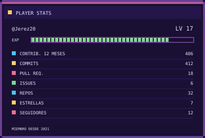
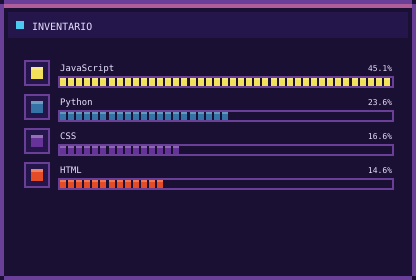
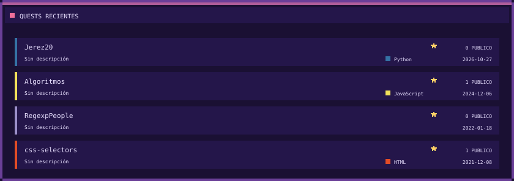
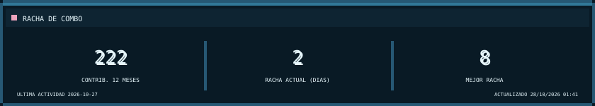

  
  

  

  

<h3 align="center">🎒 EQUIPO</h3>

  

<h3 align="center">🐍 BOSS FIGHT</h3>

  <picture>
    <source media="(prefers-color-scheme: dark)" srcset="https://raw.githubusercontent.com/Jerez20/Jerez20/output/github-snake-dark.svg" />
    
  </picture>

  
  

Tarjetas generadas a diario desde la API de GitHub · fuente Press Start 2P (OFL)

